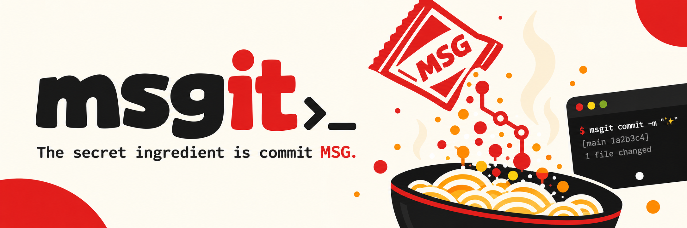

# 🧂 msgit

<p align="center">
  
</p>


[](#-license)
[](#-features)
[](#-why-msg)
[](#-how-it-works)

> **The secret ingredient is commit MSG.**  
> Your code has bugs. Your commits don't need to be bland.

`msgit` is a cheeky CLI that reads your Git diffs and generates deliciously unhinged commit messages inspired by the legendary Uncle Roger.

Because `fix stuff` is not a commit message, nephew. **HAIYAAA.** 🍚

---

## 🍳 What is this?

You know how Uncle Roger judges fried rice? Imagine that, but for your Git commits.

`msgit` looks at what you've changed, figures out what you actually did, and seasons your commit message with just the right amount of MSG.

- No more boring commit messages.
- No more staring at your terminal trying to explain 47 changed files.
- Just good commits, questionable humor, and an unhealthy amount of seasoning.

---

## 🥢 How it works

```bash
$ msgit

  msgit   🧂
  ───────────────────────────────
  The secret ingredient is MSG.

  🍚 Reading your staged changes...
  🥢 Understanding what nephew cooked...
  🧂 Adding MSG...

  ✨ FUIYOH! Your commit is seasoned.

  ╭───────────────────────────────────────────────────────────────────────╮
  │ feat(auth): validate token expiry, nephew finally check the date      │
  │                                                                       │
  │ Expired tokens no longer walk straight in.                            │
  ╰───────────────────────────────────────────────────────────────────────╯
  model: deepseek-v4-pro

  Commit this? [y/N]
```

*You write the code. We season the message.*

---

## 🔥 Features

- 🧂 **MSG-powered commits** — Turn ordinary Git diffs into flavorful commit messages.
- 🍚 **Diff-aware generation** — Messages are based on what actually changed.
- 🥢 **Uncle-approved energy** — HAIYAAA, FUIYOH, and plenty of disappointed-nephew commentary.
- ⚡ **Terminal-first** — No unnecessary UI. Just you, Git, and your questionable life decisions.
- 👨‍🍳 **Less thinking, more cooking** — Spend less time naming commits and more time shipping code.

---

## 📦 Installation

Not on npm yet. Install from a clone:

```bash
npm install
npm run build
npm link
```

`npm link` puts `msgit` on your PATH. Node.js 20 or newer, plus Git on your PATH.

msgit talks to a running [ModelHitch](https://github.com/genoventures-labs/ModelHitch) bridge. The bridge holds your provider credentials, so msgit never needs a key of its own:

```bash
modelhitch bridge --background
modelhitch status
```

Any OpenAI-compatible endpoint works instead, through `MSGIT_BASE_URL` or `--base-url`.

---

## 🚀 Usage

Stage what you want committed, then run msgit from anywhere inside the repository:

```bash
cd your-project
git add .
msgit
```

Let the chef cook.

```bash
msgit                 # generate, preview, ask, then commit
msgit --dry-run       # look at the message, never commit
msgit --yes           # commit straight away, no questions asked
msgit --plain         # professional message, zero jokes
```

| Flag | What it does |
|---|---|
| `--dry-run` | Print the message without creating a commit |
| `-y, --yes` | Commit without the confirmation prompt |
| `--plain` | Humor-free message |
| `--model <id>` | Pin a model, for example `deepseek-v4-flash` |
| `--base-url <url>` | Point at a different bridge |
| `--max-diff-chars <n>` | Cap how much of the diff gets sent |
| `--allow-secrets` | Send the diff even when it looks like it holds credentials |
| `-h, --help` | Usage information |
| `-v, --version` | Installed version |

msgit only reads the staged diff. Unstaged changes are never touched, and nothing is committed without confirmation unless you pass `--yes`.

If the staged diff looks like it contains a real credential, msgit names the file and refuses to send anything. `--allow-secrets` overrides it.

## ⚙️ Configuration

msgit reads the environment. It writes nothing to disk, and it never prints a key.

| Variable | Default | Meaning |
|---|---|---|
| `MSGIT_BASE_URL` or `MODELHITCH_BASE_URL` | `http://127.0.0.1:3939/v1` | Bridge URL. `MODELHITCH_HOST` and `MODELHITCH_PORT` also work |
| `MSGIT_MODEL` | unset | Model id. Unset lets ModelHitch rotate across its own lanes |
| `MSGIT_API_KEY` | unset | Only needed if your bridge requires one |
| `MSGIT_TIMEOUT_MS` | `60000` | Request timeout |
| `MSGIT_MAX_DIFF_CHARS` | `120000` | Diff budget sent to the model |
| `MSGIT_MAX_SUBJECT_LENGTH` | `72` | Limit for the first line |

Not built yet: a `msgit config` command and a settings file. Environment and flags are the whole story for now.

---

## 🍜 Examples

**You finally fixed a bug:**
```text
fix(queue): stop retrying when the queue is empty, no more stubborn wok
```

**You added a feature:**
```text
feat(theme): add dark mode, nephew hide the bugs in the dark
```

**You refactored your spaghetti code:**
```text
refactor(parser): split the tokenizer, uncle separate the ingredients first
```

**You deleted 2,000 lines:**
```text
chore: drop dead helpers, fuiyoh less ingredient better flavor
```

**You fixed something you broke yesterday:**
```text
fix(api): restore the retry guard, uncle apologize to yesterday
```

---

## 🧂 Why MSG?

Because every good dish needs seasoning. And every good repository needs meaningful commit messages.

MSG stands for:
- **M**onosodium
- **S**odium? *No, nephew. Already got sodium.*
- **G**lutamate.

It also means **M**es**S**a**G**e. And there's Git.

Look, don't overthink it. Just add MSG.

---

## 🤝 Contributing

Pull requests are welcome!

- Found a bug? Open an issue.
- Want to add more flavor? Submit a PR.
- Writing a commit message manually? **HAIYAAA. WE BUILT A WHOLE TOOL FOR THIS.**

Working on msgit itself:

```bash
npm run dev -- --dry-run    # run straight from source
npm test                    # unit tests plus real git integration tests
npm run typecheck
npm run build
```

---

## ⚠️ Disclaimer

`msgit` is an independent parody-inspired developer tool and is not affiliated with, endorsed by, or officially associated with Uncle Roger or Nigel Ng. The humor is inspired by the character's comedic style, not an official collaboration.

---

## 📜 License

MIT. See [LICENSE](./LICENSE).

---

<div align="center">

Made with 🧂, questionable commit history, and excessive amounts of MSG.  
*No fried rice was harmed in the making of this CLI.*  
**FUIYOOOOH! 🔥**

</div>